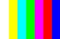
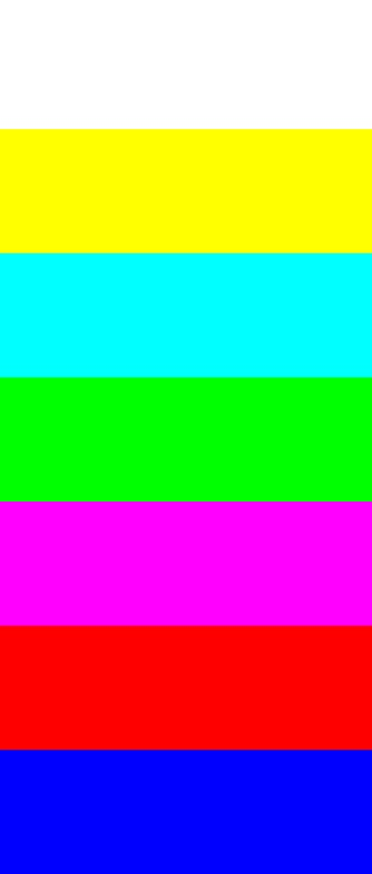
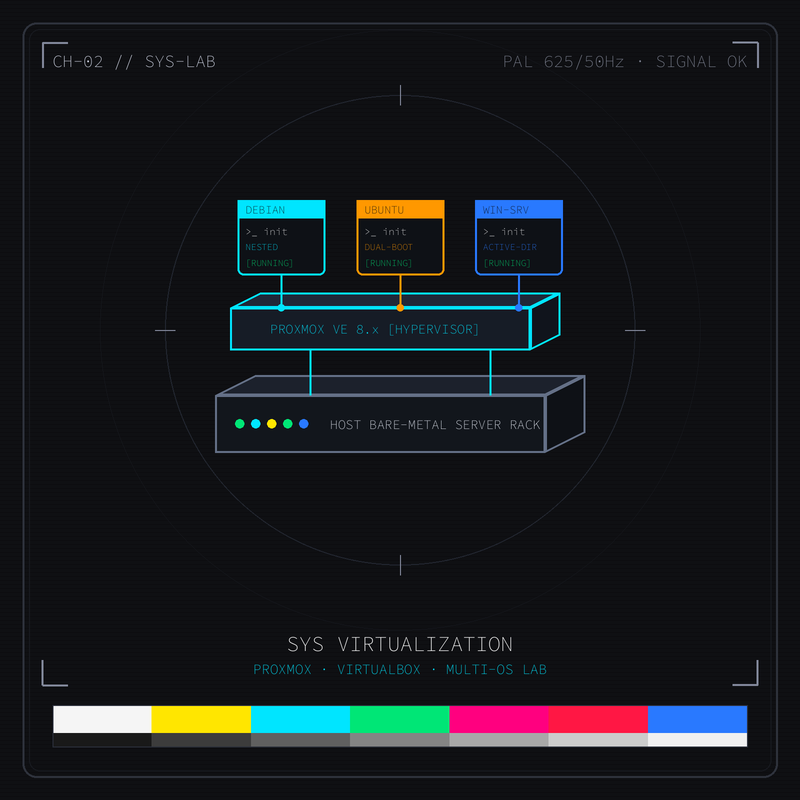

# Informe Técnico de Refactorización: Portfolio Web

Este documento detalla exhaustivamente todos los cambios implementados entre la rama original (`main`) y la rama de refactorización ([`refactor/frontend-architecture-and-standards`](file:///media/electorado/Desarrollo/dePagüer/Proyectos_DAM/Portfolio_LM)), desglosados archivo por archivo con comparativas de código (**Antes vs. Después**) y la justificación técnica de cada decisión (**Por qué**).

---

## 1. [index.html](file:///media/electorado/Desarrollo/dePagüer/Proyectos_DAM/Portfolio_LM/index.html)

### 1.1 Jerarquía del Encabezado y Título Principal

#### Antes (`main`):
```html
<div class="nombre">
    <a href="#descripcion">
        <h1><span class="nombre1">pablo</span><span class="nombre2 nombre-gris">andrés</span>
            <br> <span class="apellido1">moncayo</span><span class="apellido2 nombre-gris">vega</span>
        </h1>
    </a>
</div>
```

#### Después (`refactor`):
```html
<h1 class="nombre">
    <a href="#descripcion" aria-label="Pablo Andrés Moncayo Vega - Ir al inicio">
        <span class="nombre1">pablo</span><span class="nombre2 nombre-gris">andrés</span>
        <br aria-hidden="true">
        <span class="apellido1">moncayo</span><span class="apellido2 nombre-gris">vega</span>
    </a>
</h1>
```

#### ¿Por qué?
1. **Estándares W3C y Árbol de Accesibilidad (AOM):** En HTML semántico, un enlace `<a>` no debe envolver a un encabezado de nivel superior `<h1>`. La estructura jerárquica correcta sitúa al `<h1>` como contenedor estructural del título y dentro el elemento interactivo `<a>`.
2. **Lectores de pantalla:** La etiqueta `<br>` dentro de un enlace provoca que algunos lectores de pantalla anuncien el nombre como frases fragmentadas o lean el salto de línea como una pausa no deseada. Se solucionó añadiendo `aria-label="Pablo Andrés Moncayo Vega - Ir al inicio"` en el enlace y `aria-hidden="true"` al `<br>`, garantizando una lectura fluida para usuarios con discapacidad visual y manteniendo intacto el diseño visual en dos líneas.

---

### 1.2 Botones y Semántica del Menú de Navegación

#### Antes (`main`):
```html
<!-- Botón abrir -->
<div class="menu" id="abrirMenu">
    <br><span>MENÚ</span>
</div>

<!-- Menú lateral y botón cerrar -->
<div class="menu-desplegado" id="menuLateral">
    
    <div class="items-menu">
        <div class="cerrar-menu" id="cerrarMenu">
            
        </div>
        <a href="#info">&lt;Info&gt;</a>
        <a href="#proyectos">&lt;Mis<br>proyectos&gt;</a>
        <a href="#intereses">&lt;Me<br>interesa&gt;</a>
    </div>
</div>
```

#### Después (`refactor`):
```html
<!-- Botón abrir semántico -->
<button type="button" class="menu" id="abrirMenu" aria-expanded="false" aria-controls="menuLateral" aria-label="Abrir menú de navegación">
    
    <span class="menu-texto">MENÚ</span>
</button>

<!-- Menú lateral con barra superior flotante -->
<nav class="menu-desplegado" id="menuLateral" aria-label="Navegación principal">
    <div class="menu-top-bar">
        <a href="#descripcion" class="icono-home" id="homeMenuBtn" aria-label="Volver al inicio">
            <svg width="25" height="25" viewBox="0 0 24 24" fill="none" stroke="currentColor" stroke-width="2.3" stroke-linecap="round" stroke-linejoin="round" aria-hidden="true" focusable="false">
                <path d="M3 9.5L12 3l9 6.5V20a1 1 0 0 1-1 1h-5a1 1 0 0 1-1-1v-5a1 1 0 0 0-1-1h-2a1 1 0 0 0-1 1v5a1 1 0 0 1-1 1H4a1 1 0 0 1-1-1V9.5z" />
            </svg>
        </a>

        <button type="button" class="cerrar-menu" id="cerrarMenu" aria-label="Cerrar menú de navegación">
            <svg class="icono-cerrar" width="25" height="25" viewBox="0 0 24 24" fill="none" stroke="currentColor" stroke-width="2.5" stroke-linecap="round" stroke-linejoin="round" aria-hidden="true" focusable="false">
                <line x1="18" y1="6" x2="6" y2="18"></line>
                <line x1="6" y1="6" x2="18" y2="18"></line>
            </svg>
        </button>
    </div>

    <div class="items-menu">
        <a href="#info">Info</a>
        <a href="#proyectos">Mis<br>proyectos</a>
        <a href="#intereses">Me<br>interesa</a>
    </div>
</nav>
```

#### ¿Por qué?
1. **Sustitución de `div` interactivos por `<button>` nativos:** Los elementos `<div>` no son enfocables por teclado ni anuncian su función de botón a la tecnología asistencial a menos que se les añada `tabindex="0"`, `role="button"` y listeners manuales de `Enter` y `Space`. Un `<button type="button">` ofrece todo esto de forma nativa.
2. **Atributos ARIA:** `aria-expanded="false"` y `aria-controls="menuLateral"` informan a los usuarios invidentes si el panel de navegación está desplegado o replegado.
3. **Limpieza de caracteres `<` y `>`:** En el código original estaban escritos directamente como entidades HTML (`&lt;Info&gt;`), por lo que los lectores de pantalla vocalizaban *"menor que Info mayor que"*. Se eliminaron del HTML y ahora se agregan como pseudo-elementos puramente decorativos en CSS (`::before` y `::after`), invisibles para el lector de pantalla.
4. **Iconos vectoriales limpios:**
   - La imagen de cierre (`img/Equis.jpg`) se sustituyó por un SVG vectorial flotante de alta resolución que no se pixela en pantallas Retina ni requiere descarga HTTP de un mapa de bits adicional.
   - Se añadió un botón flotante con el icono de inicio (Home) en la esquina superior izquierda del menú desplegado.
5. **Eliminación de la etiqueta `` de fondo:** La imagen `img/menu_desplegado.jpg` ya no sobrecarga el DOM como un elemento `` con `position: absolute; z-index: -1`, sino como propiedad CSS `background-image` en el contenedor `<nav>`.

---

### 1.3 Sección "Sobre mí": Reestructuración de la Foto y Cuadrícula Semántica

#### Antes (`main`):
```html
<div id="info" class="contenido">
    <div class="info-header">
        <h2>Sobre mí</h2>
        
    </div>

    <p>Mi trayectoria como cocinero...</p>
    <p>Además de mi gusto por la informática...</p>
    <p>Actualmente, estoy tomándome...</p>

    <div class="acordeon-grid">
        <details class="acordeon-item">
            <summary><span>Estudios</span><span class="icono-mas">+</span></summary>
            <div class="acordeon-contenido"><ul>...</ul></div>
        </details>
        <details class="acordeon-item">
            <summary><span>Cursos</span><span class="icono-mas">+</span></summary>
            ...
        </details>
        <!-- Más details/summary -->
    </div>
</div>
```

#### Después (`refactor`):
```html
<div id="info" class="contenido">
    <h2>Sobre mí</h2>

    <div class="info-presentacion">
        <div class="info-bio">
            <p>Mi trayectoria como cocinero...</p>
            <p>Además de mi gusto por la informática...</p>
            <p>Actualmente, estoy tomándome...</p>
        </div>

        <div class="info-foto">
            
        </div>
    </div>

    <div class="info-grid">
        <section class="info-card" aria-labelledby="titulo-estudios">
            <h3 id="titulo-estudios">Estudios</h3>
            <ul>...</ul>
        </section>
        <section class="info-card" aria-labelledby="titulo-cursos">
            <h3 id="titulo-cursos">Cursos</h3>
            <ul>...</ul>
        </section>
        <section class="info-card" aria-labelledby="titulo-experiencia">
            <h3 id="titulo-experiencia">Experiencia</h3>
            <ul>...</ul>
        </section>
        <section class="info-card" aria-labelledby="titulo-idiomas">
            <h3 id="titulo-idiomas">Idiomas</h3>
            <ul>...</ul>
        </section>
    </div>
</div>
```

#### ¿Por qué?
1. **Reubicación de la fotografía:** En el diseño anterior, la foto estaba anclada en `.info-header` con un `transform: translate(-4.5vw, 1.6vw)` que provocaba que se cortara por la mitad bajo el encabezado fijo al pulsar "Info". Al colocarla al lado derecho de los párrafos introductorios dentro de `.info-presentacion`:
   - Se soluciona definitivamente el corte superior.
   - Sigue el patrón visual limpio y asimétrico de la referencia estética de animación (`buōy`).
2. **Sustitución de `<details>` y `<summary>` por tarjetas semánticas:**
   - La información curricular (estudios, cursos, experiencia e idiomas) ahora está visible permanentemente sin exigir clics ni interacción innecesaria.
   - Estructura semántica con `<section class="info-card" aria-labelledby="...">` y encabezados `<h3>`, lo que permite a motores de búsqueda (SEO) y tecnologías de asistencia indexar y navegar por la trayectoria completa.
3. **Optimización de imágenes (Core Web Vitals):** Se añadieron `loading="lazy"` y `decoding="async"`, junto con los atributos explícitos `width="990"` y `height="1233"` para evitar saltos de diseño acumulativos (**CLS - Cumulative Layout Shift**).

---

### 1.4 Sección Proyectos: Optimización de Medios

#### Antes (`main`):
```html
<article class="proyecto">
    <a href="..." class="project-header" target="_blank" rel="noopener noreferrer">
        <h3>Virtualización de sistemas operativos y servidores</h3>
        
    </a>
    <p>...</p>
</article>
```

#### Después (`refactor`):
```html
<article class="proyecto">
    <a href="..." class="project-header" target="_blank" rel="noopener noreferrer">
        <h3>Virtualización de sistemas operativos y servidores</h3>
        
    </a>
    <p>...</p>
</article>
```

#### ¿Por qué?
1. **Atributo `alt` descriptivo:** Las imágenes carecían del atributo `alt`, lo que constituía una infracción de nivel A de las pautas WCAG 2.1.
2. **Rendimiento:** Las imágenes en formato PNG de alta resolución (2048x2048) pesaban varios megabytes. Con `loading="lazy"` solo se descargan cuando el usuario se aproxima a la sección de proyectos, acelerando notablemente la carga inicial (**FCP** y **LCP**).
3. **Prevención de CLS:** La declaración explícita de `width="2048"` y `height="2048"` permite al navegador calcular la relación de aspecto (`aspect-ratio: 1 / 1`) antes de descargar los bytes de la imagen, evitando tirones en el scroll.

---

### 1.5 Footer y Sección Legal Unificada

#### Antes (`main`):
```html
<footer>
    <div class="social-iconos">
        <a href="https://www.linkedin.com/in/pablomoncayovega/" target="_blank">
            
        </a>
        <a href="https://github.com/electorado" target="_blank">
            
        </a>
        <a href="mailto:pamoncayo@gmail.com">
            
        </a>
        <p>© 2025 Pablo A.<br> Moncayo Vega</p>
    </div>
</footer>

<div class="legal">
    <a href="privacidad.html" target="_blank" rel="noopener noreferrer">Política de<br>privacidad</a>
</div>
```

#### Después (`refactor`):
```html
<footer id="footerBar">
    <div class="social-iconos">
        <a href="https://www.linkedin.com/in/pablomoncayovega/" target="_blank" rel="noopener noreferrer" aria-label="Perfil de LinkedIn de Pablo Moncayo">
            
        </a>
        <a href="https://github.com/electorado" target="_blank" rel="noopener noreferrer" aria-label="Perfil de GitHub de Pablo Moncayo">
            
        </a>
        <a href="mailto:pamoncayo@gmail.com" aria-label="Enviar correo electrónico a Pablo Moncayo">
            
        </a>
        <p class="copyright">© 2025 Pablo A.<br> Moncayo Vega</p>
    </div>

    <div class="legal">
        <a href="privacidad.html" target="_blank" rel="noopener noreferrer">Política de<br>privacidad</a>
    </div>
</footer>
```

#### ¿Por qué?
1. **Unificación en una sola barra continua:** `.legal` ya no es un elemento flotante huérfano con `position: fixed` independiente. Ahora convive dentro del elemento semántico `<footer>`, permitiendo que la barra completa se expanda al 100% o se ajuste dinámicamente al menú desplegado.
2. **Nombres accesibles (`aria-label`) y seguridad:** Los enlaces que solo contienen imágenes vectoriales no tienen texto visible para lectores de pantalla. Con `aria-label="Perfil de LinkedIn..."` y `alt="" aria-hidden="true"` en los iconos, la accesibilidad es total. Además, se añadió `rel="noopener noreferrer"` en los enlaces externos para mitigar vulnerabilidades de seguridad (*tabnabbing*).

---

## 2. [css/style.css](file:///media/electorado/Desarrollo/dePagüer/Proyectos_DAM/Portfolio_LM/css/style.css)

### 2.1 Variables Globales (`:root`) y Accesibilidad de Foco

#### Antes (`main`):
```css
/* No existían variables CSS */
* {
    margin: 0;
    padding: 0;
    box-sizing: border-box;
}

body {
    background-color: #171616;
    color: #ebe1e1;
    font-family: 'Source Code Pro', monospace;
    ...
}
```

#### Después (`refactor`):
```css
:root {
    --header-height: clamp(7.5rem, 16vw, 10rem);
    --menu-width: min(28vw, 230px);
    --color-bg: #171616;
    --color-text: #ebe1e1;
    --color-accent: #0000ae;
}

/* Accesibilidad: Foco visible universal */
:focus-visible {
    outline: 2px solid #58a6ff;
    outline-offset: 3px;
}

button:focus-visible,
a:focus-visible,
input:focus-visible {
    outline: 2px solid #58a6ff;
    outline-offset: 3px;
    border-radius: 2px;
}
```

#### ¿Por qué?
1. **Centralización con Custom Properties:** La altura del encabezado (`--header-height`) y el ancho del menú (`--menu-width`) se calculan en un único punto, permitiendo que el cálculo del `scroll-margin-top` y la animación del pie de página dependan de los mismos valores.
2. **Navegación por teclado (WCAG 2.4.7 Focus Visible):** Se implementó `:focus-visible` para garantizar que los usuarios que navegan mediante tabulación visualicen con claridad el control activo mediante un contorno azul contrastado, sin interferir con la experiencia de quienes usan ratón.

---

### 2.2 Normalización del Scroll Global y Corrección en `main`

#### Antes (`main`):
```css
main {
    width: min(74%, 150ch);
    align-self: flex-start;
    padding-left: 3.25%;
    font-size: clamp(0.8rem, 3.5cqw, 1.2rem);
    font-weight: 380;
    text-align: justify;
    overflow-y: auto;          /* Scroll secundario problemático */
    scrollbar-width: none;
    -ms-overflow-style: none;
}

main::-webkit-scrollbar {
    width: 0.5em;
    background-color: transparent;
}
```

#### Después (`refactor`):
```css
main {
    width: min(70%, 150ch);
    align-self: flex-start;
    padding-left: 3.25%;
    padding-right: clamp(1.5rem, 4vw, 3.5rem);
    font-size: clamp(0.8rem, 3.5cqw, 1.2rem);
    font-weight: 380;
    text-align: justify;
}
```

#### ¿Por qué?
1. **Eliminación del doble scroll / "Scroll Hijacking":** Colocar `overflow-y: auto` en `main` mientras `body` o `html` también tienen scroll rompía el comportamiento natural de la rueda del ratón y el gesto táctil en móviles, además de impedir que el navegador gestionara adecuadamente los saltos por ancla (`#info`, `#proyectos`). El desplazamiento ahora pertenece exclusivamente a la ventana global (`html`/`body`).
2. **Margen de lectura derecho:** Se añadió `padding-right: clamp(1.5rem, 4vw, 3.5rem)` para que cuando el menú lateral esté desplegado, los textos nunca colisionen contra su borde.

---

### 2.3 Centrado de la Landing Page (`.descripcion`)

#### Antes (`main`):
```css
.descripcion {
    padding-top: clamp(8rem, 35vw, 22rem);
    min-height: 100vh;
    color: #C5B5B5;
    scroll-margin-top: clamp(5rem, 6vw, 5rem);
}
```

#### Después (`refactor`):
```css
.descripcion {
    min-height: 100vh;
    display: flex;
    flex-direction: column;
    justify-content: center;
    padding-top: clamp(8rem, 15vh, 12rem);
    padding-bottom: clamp(5rem, 10vh, 8rem);
    color: #C5B5B5;
    scroll-margin-top: clamp(8.5rem, 15vw, 13.5rem);
}
```

#### ¿Por qué?
- El uso previo de `clamp(8rem, 35vw, 22rem)` dependía excesivamente del ancho de pantalla (`vw`), provocando que en pantallas panorámicas o monitores altos el texto quedara desproporcionadamente pegado al nombre superior o muy desplazado.
- Al emplear `display: flex; flex-direction: column; justify-content: center;` con `min-height: 100vh` y un `padding-top` que amortigua el encabezado fijo, el texto introductorio queda situado en el centro vertical de la pantalla de bienvenida en cualquier resolución.

---

### 2.4 Aislamiento Limpio de Secciones y Márgenes de Anclaje

#### Antes (`main`):
```css
#info, #proyectos, #intereses {
    scroll-margin-top: clamp(6rem, 22vw, 17rem);
    min-height: 85vh;
}
```

#### Después (`refactor`):
```css
#info, #proyectos, #intereses {
    scroll-margin-top: clamp(8.5rem, 15vw, 13.5rem);
    min-height: 85vh;
}

#info {
    width: 100%;
    filter: saturate(70%) contrast(80%);
    padding-bottom: clamp(10rem, 25vh, 18rem);
}

#proyectos {
    padding-bottom: clamp(10rem, 25vh, 18rem);
}
```

#### ¿Por qué?
1. **Evitar que se vea la sección anterior:** En la versión original, al navegar a *"Mis proyectos"* o *"Me interesa"*, las tarjetas grises de la sección previa asomaban por arriba.
2. **Solución:** Se añadió un `padding-bottom: clamp(10rem, 25vh, 18rem)` al final de cada sección para crear una zona de separación nítida. Al calibrar el `scroll-margin-top`, cada sección comienza despejada directamente bajo el encabezado sin residuos de la anterior.

---

### 2.5 Menú Desplegado: Fondo CRT, Botones Flotantes y Pseudo-elementos

#### Antes (`main`):
```css
.menu-desplegado {
    position: fixed;
    top: 0;
    right: -100%;
    width: min(24vw, 210px);
    height: 100%;
    z-index: 2002 !important;
    transition: right 0.5s ease-in-out;
    overflow: hidden;
    display: flex;
    justify-content: left;
    align-items: center;
}

.menu-desplegado .menu-bg {
    position: absolute;
    top: 0;
    left: 0;
    width: 100%;
    height: 100%;
    object-fit: cover;
    z-index: -1;
    filter: saturate(99%) contrast(75%);
}

.cerrar-menu {
    position: absolute;
    top: 1%;
    right: 3%;
    cursor: pointer;
    z-index: 10;
}
```

#### Después (`refactor`):
```css
.menu-desplegado {
    position: fixed;
    top: 0;
    right: -100%;
    width: var(--menu-width);
    height: 100%;
    z-index: 40;
    transition: right 0.4s cubic-bezier(0.16, 1, 0.3, 1);
    overflow-y: auto;
    display: flex;
    flex-direction: column;
    justify-content: flex-start;
    align-items: flex-start;
    padding: 0;
    background-color: #171616;
    background-image: url('../img/menu_desplegado.jpg');
    background-size: 100% 100%;
    background-position: center;
    background-repeat: no-repeat;
    box-shadow: -4px 0 25px rgba(0, 0, 0, 0.85);
}

/* Barra superior y botones flotantes */
.menu-top-bar {
    width: 100%;
    display: flex;
    justify-content: space-between;
    align-items: center;
    padding: 1.25rem 1.25rem 0 1.25rem;
    z-index: 10;
}

.icono-home,
button.cerrar-menu {
    background: transparent;
    border: none;
    box-shadow: none;
    color: #0000ae;
    cursor: pointer;
    padding: 0.35rem;
    filter: drop-shadow(0 0 3px #ffffff) drop-shadow(0 0 6px #ffffff);
    transition: transform 0.2s ease, color 0.2s ease;
}

.icono-home:hover,
button.cerrar-menu:hover {
    transform: scale(1.2);
    background: transparent;
    color: #000066;
}

/* Enlaces con corchetes en CSS y tipografía fina */
.menu-desplegado .items-menu a {
    color: var(--color-accent);
    text-decoration: none;
    font-size: clamp(1.05rem, 3.8cqw, 1.9rem);
    font-weight: 400;
    text-shadow: 0 0 3px #ffffff, 0 0 6px #ffffff;
    display: inline-block;
    transition: transform 0.2s ease, color 0.2s ease;
}

.menu-desplegado .items-menu a::before { content: "<"; }
.menu-desplegado .items-menu a::after  { content: ">"; }
```

#### ¿Por qué?
1. **Fondo CRT con franjas horizontales:** Se aplica directamente en CSS con `background-image: url('../img/menu_desplegado.jpg')` y `background-size: 100% 100%`. Esto conserva el grano analógico original, las líneas de escaneo y el sangrado entre colores.
2. **Iconos flotantes sin recuadro blanco:** Se eliminó cualquier marco o fondo blanco cuadrado en el botón de cerrar (`#cerrarMenu`). Ahora la X y el icono de la casa son elementos vectoriales flotantes con un sutil resplandor blanco (`drop-shadow`) que garantiza un contraste nítido sobre cualquiera de las franjas de color.
3. **Grosor tipográfico afinado:** `font-weight: 400` en los textos del menú para mantener la delicadeza visual del diseño original.

---

### 2.6 Corrección de Errores de Sintaxis y Capas de Apilamiento (`z-index`)

#### Antes (`main`):
```css
header {
    ...
    z-index: 2002 !important; /* !important arbitrario */
}

a.project-header img {
    width: 35%;
    height: 35%px;            /* ERROR DE SINTAXIS CSS INVÁLIDO */
    object-fit: cover;
    flex-shrink: 0;
    border-radius: 4px;
}

footer {
    ...
    z-index: 2001 !important;
}

.legal {
    ...
    z-index: 2003 !important;
}
```

#### Después (`refactor`):
```css
header {
    ...
    z-index: 10;
}

footer {
    ...
    z-index: 20;
}

.menu-desplegado {
    ...
    z-index: 40;
}

.cookie-popup {
    ...
    z-index: 50;
}

a.project-header img {
    width: 35%;
    height: auto;
    aspect-ratio: 1 / 1;
    object-fit: cover;
    flex-shrink: 0;
    border-radius: 4px;
}
```

#### ¿Por qué?
1. **Corrección de sintaxis:** `height: 35%px;` era un valor no estándar que provocaba que los motores de renderizado ignoraran la regla o produjeran comportamientos impredecibles. Se sustituyó por `height: auto; aspect-ratio: 1 / 1;`.
2. **Capas lógicas sin `!important`:** Los valores exagerados como `2002 !important` impedían una gestión predecible de los apilamientos. Se estructuró un orden limpio:
   - Contenido base: `0`
   - Encabezado: `10`
   - Pie de página (footer): `20`
   - Menú lateral abierto: `40`
   - Diálogo de cookies modal: `50`

---

### 2.7 Barra Inferior Dinámica y Adaptación Móvil

#### Antes (`main`):
```css
footer {
    position: fixed;
    bottom: 0;
    left: 0;
    width: 75%;
    height: clamp(3.4rem, 8vw, 4.5rem);
    display: flex;
    font-family: 'Wix Madefor Display', sans-serif;
    font-size: clamp(0.7rem, 0.9vw, 5rem);
    color: #616161;
    justify-content: space-between;
    align-items: flex-end;
    text-align: right;
    z-index: 2001 !important;
    background: #171616;
    padding-left: 3.1%;
}

.social-iconos img {
    width: clamp(2.3rem, 6.5vw, 3.3rem); /* Excesivamente grandes */
    ...
}
```

#### Después (`refactor`):
```css
footer {
    position: fixed;
    bottom: 0;
    left: 0;
    width: 100%;
    height: clamp(2.8rem, 5.5vw, 3.4rem);
    display: flex;
    justify-content: space-between;
    align-items: center;
    font-family: 'Wix Madefor Display', sans-serif;
    color: #616161;
    z-index: 20;
    background: var(--color-bg);
    padding-left: 3.1%;
    padding-right: 3.1%;
    transition: width 0.4s cubic-bezier(0.16, 1, 0.3, 1), padding 0.4s ease;
}

/* Cuando el menú lateral está abierto, la barra llega exactamente hasta el menú */
body.menu-abierto footer {
    width: calc(100% - var(--menu-width));
    padding-right: 1.5rem;
}

/* Iconos de tamaño equilibrado en desktop */
.social-iconos img {
    width: clamp(1.25rem, 1.6vw, 1.55rem);
    height: clamp(1.25rem, 1.6vw, 1.55rem);
    filter: invert(86%) brightness(100%);
    transition: transform 0.2s ease-in-out, opacity 0.2s ease-in-out;
}

/* En móvil: iconos más grandes y accesibles táctilmente */
@media (max-width: 768px) {
    footer {
        height: 3.2rem;
        padding-left: 4%;
        padding-right: 4%;
    }

    .social-iconos img {
        width: 1.75rem;
        height: 1.75rem;
    }

    body.menu-abierto footer .copyright {
        display: none;
    }
}
```

#### ¿Por qué?
1. **Comportamiento dinámico solicitado:** La barra inferior abarca el `100%` de la pantalla mientras el menú está cerrado, y se contrae de forma fluida hasta `calc(100% - var(--menu-width))` en cuanto se abre el menú, eliminando cualquier choque o solapamiento.
2. **Escala táctil en móviles (WCAG 2.5.5):** En pantallas pequeñas los iconos aumentan a `1.75rem` (`~28px`) para facilitar la pulsación táctil con el pulgar, mientras que en pantallas de sobremesa se mantienen en un tamaño refinado y discreto.

---

## 3. [js/script.js](file:///media/electorado/Desarrollo/dePagüer/Proyectos_DAM/Portfolio_LM/js/script.js)

### 3.1 Control de Accesibilidad, Teclado y Persistencia del Menú

#### Antes (`main`):
```javascript
// --- CÓDIGO DEL MENÚ DESPLEGABLE ---
const abrirMenuBtn = document.getElementById('abrirMenu');
const cerrarMenuBtn = document.getElementById('cerrarMenu');
const menuLateral = document.getElementById('menuLateral');
const legalDiv = document.querySelector('.legal');
const menuLinks = document.querySelectorAll('#menuLateral .items-menu a');

function abrirMenu() {
    if (menuLateral) {
        menuLateral.classList.add('activo');
    }
     if (abrirMenuBtn) {
        abrirMenuBtn.style.visibility = 'hidden'; 
    }
    if (legalDiv) {
        legalDiv.classList.add('menu-abierto');
    }
}

function cerrarMenu() {
    if (menuLateral) {
        menuLateral.classList.remove('activo');
    }
    if (abrirMenuBtn) {
        abrirMenuBtn.style.visibility = 'visible'; 
    }
    if (legalDiv) {
        legalDiv.classList.remove('menu-abierto');
    }
}

if (abrirMenuBtn && cerrarMenuBtn && menuLateral) {
    abrirMenuBtn.addEventListener('click', abrirMenu);
    cerrarMenuBtn.addEventListener('click', cerrarMenu);
    
    // Cerraba el menú cada vez que se hacía clic en un enlace
    menuLinks.forEach(link => {
        link.addEventListener('click', cerrarMenu);
    });
}

// Lógica de acordeones obsoleta
const acordeonItems = document.querySelectorAll('.acordeon-item');
acordeonItems.forEach(item => {
  item.addEventListener('toggle', (event) => {
    if (item.open) {
      acordeonItems.forEach(otroItem => {
        if (otroItem !== item) otroItem.open = false;
      });
    }
  });
});
```

#### Después (`refactor`):
```javascript
// --- CÓDIGO DEL MENÚ DESPLEGABLE ---
const abrirMenuBtn = document.getElementById('abrirMenu');
const cerrarMenuBtn = document.getElementById('cerrarMenu');
const menuLateral = document.getElementById('menuLateral');

function abrirMenu() {
    if (menuLateral) {
        menuLateral.classList.add('activo');
    }
    if (abrirMenuBtn) {
        abrirMenuBtn.setAttribute('aria-expanded', 'true');
        abrirMenuBtn.style.visibility = 'hidden';
    }
    document.body.classList.add('menu-abierto');
    if (cerrarMenuBtn) {
        cerrarMenuBtn.focus();
    }
}

function cerrarMenu(returnFocus = true) {
    if (menuLateral) {
        menuLateral.classList.remove('activo');
    }
    if (abrirMenuBtn) {
        abrirMenuBtn.setAttribute('aria-expanded', 'false');
        abrirMenuBtn.style.visibility = 'visible';
        if (returnFocus) {
            abrirMenuBtn.focus();
        }
    }
    document.body.classList.remove('menu-abierto');
}

if (abrirMenuBtn && cerrarMenuBtn && menuLateral) {
    abrirMenuBtn.addEventListener('click', abrirMenu);

    cerrarMenuBtn.addEventListener('click', () => {
        cerrarMenu(true);
    });

    // Menú persistente: ya no se cierra al hacer clic en un enlace.
    // Permanece abierto para que el usuario navegue entre opciones libremente.

    // Soporte para teclado (WCAG 2.1.1): cerrar con Escape y devolver foco
    document.addEventListener('keydown', (event) => {
        if (event.key === 'Escape' && menuLateral.classList.contains('activo')) {
            cerrarMenu(true);
        }
    });

    // Cerrar al hacer clic fuera del menú lateral
    document.addEventListener('click', (event) => {
        if (
            menuLateral.classList.contains('activo') &&
            !menuLateral.contains(event.target) &&
            !abrirMenuBtn.contains(event.target)
        ) {
            cerrarMenu(false);
        }
    });
}
```

#### ¿Por qué?
1. **Sincronización del estado accesible:** Se actualiza `aria-expanded="true"` al abrir y `aria-expanded="false"` al cerrar sobre el botón disparador.
2. **Gestión del foco (Focus Management):** Al abrir el menú, el foco se transfiere automáticamente a `cerrarMenuBtn.focus()`. Al cerrarlo, se restituye a `abrirMenuBtn.focus()`, evitando que usuarios de teclado o lectores de pantalla queden desorientados en el árbol del documento.
3. **Cierre con tecla `Escape`:** Cumple el estándar de interacción de diálogos/menús emergentes de la W3C (WAI-ARIA Dialog/Drawer Pattern).
4. **Menú persistente durante la navegación:** Se eliminó el cierre forzado en cada enlace. El panel se mantiene abierto permitiendo al usuario saltar de sección en sección con comodidad y solo se cierra cuando el usuario lo desea expresamente (botón X, tecla Escape o clic fuera).
5. **Limpieza de código muerto:** Al reemplazar los acordeones `<details>` por cuadrículas estáticas en HTML, se eliminó toda la lógica JS innecesaria de escucha del evento `toggle`.

---

## 4. Historial de Commits Atómicos (Conventional Commits)

Los cambios fueron organizados en commits atómicos dentro de la rama:

| Commit | Mensaje | Descripción |
| :--- | :--- | :--- |
| [`38a5b22`](file:///media/electorado/Desarrollo/dePagüer/Proyectos_DAM/Portfolio_LM/index.html) | `refactor(html): improve accessibility and semantic structure` | Botones semánticos, atributos ARIA, eliminación de detalles/acordeón y lazy loading. |
| [`fad64de`](file:///media/electorado/Desarrollo/dePagüer/Proyectos_DAM/Portfolio_LM/css/style.css) | `refactor(css): normalize layout and remove asset bloat` | Variables globales, normalización de scroll y corrección de sintaxis. |
| [`1ebbdb3`](file:///media/electorado/Desarrollo/dePagüer/Proyectos_DAM/Portfolio_LM/js/script.js) | `refactor(js): improve menu accessibility and keyboard navigation` | Sincronización `aria-expanded`, soporte tecla Escape y gestión de foco. |
| [`79f7757`](file:///media/electorado/Desarrollo/dePagüer/Proyectos_DAM/Portfolio_LM/css/style.css) | `fix(ui): restore horizontal CRT menu background and improve responsive layout` | Franjas CRT horizontales en el menú desplegado y reubicación de la foto de perfil. |
| [`1a463a6`](file:///media/electorado/Desarrollo/dePagüer/Proyectos_DAM/Portfolio_LM/index.html) | `feat(ui): dynamic full-width footer, mobile icon scaling, and Philips testcard menu icon` | Barra inferior al 100%, ajuste dinámico al menú y escala en móvil. |
| [`31bd1d6`](file:///media/electorado/Desarrollo/dePagüer/Proyectos_DAM/Portfolio_LM/css/style.css) | `fix(layout): ensure section headings are not clipped by header and increase landing text spacing` | Calibración de `scroll-margin-top` para evitar cortes en títulos. |
| [`03758fb`](file:///media/electorado/Desarrollo/dePagüer/Proyectos_DAM/Portfolio_LM/index.html) | `feat(nav): add floating home and close icons, keep menu open on navigate, and isolate section views` | Iconos flotantes (Home y X sin recuadros) y menú persistente al navegar. |
| [`e38653b`](file:///media/electorado/Desarrollo/dePagüer/Proyectos_DAM/Portfolio_LM/index.html) | `fix(theme): restore original menu button icon and project font styles` | Restauración del icono del botón del menú y de las fuentes nativas del proyecto. |
| [`bc14361`](file:///media/electorado/Desarrollo/dePagüer/Proyectos_DAM/Portfolio_LM/css/style.css) | `style(menu): reduce font-weight on menu button and drawer links` | Ajuste a peso fino (`font-weight: 400`) en "MENÚ" y enlaces del menú. |
| [`92c7058`](file:///media/electorado/Desarrollo/dePagüer/Proyectos_DAM/Portfolio_LM/css/style.css) | `style(landing): vertically center bio introduction text on the landing viewport` | Centrado vertical de la introducción en la landing page mediante Flexbox. |
